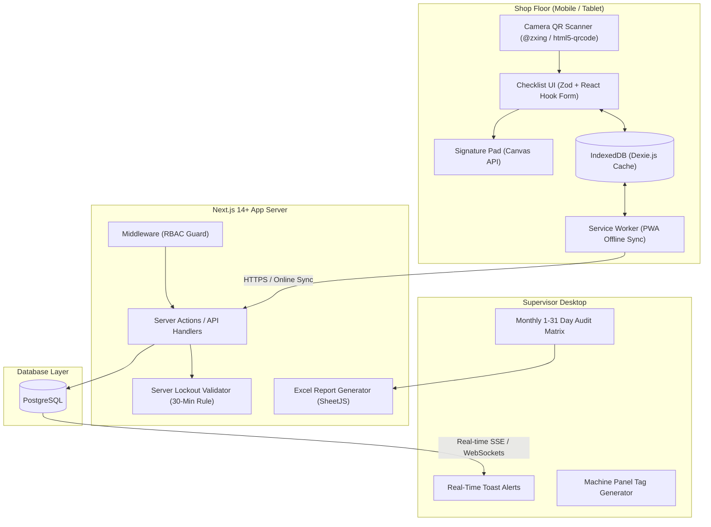
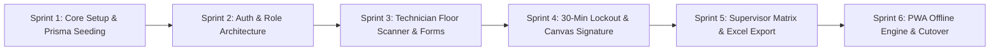

# Next.js Enterprise Architecture & Implementation Plan
## Alumex Industrial Maintenance Portal (Extrusion & VPC)

**Document Reference:** ALX-NEXTJS-CMMS-2026  
**Target Architecture:** Next.js 14+ (App Router), TypeScript, Tailwind CSS, shadcn/ui, PostgreSQL, Prisma ORM, Offline PWA  
**System Scope:** Extrusion Plant (`CH/MT/102`) & VPC Plant (`LS/MT/102`) — 146 Checkpoints across 13 Stations  

---

## 1. Executive Summary & Recommended Technology Stack

Transforming the standalone single-file `index.html` into a production-grade enterprise web application requires shifting from client-only in-memory storage to a resilient, offline-first client/server architecture with server-authoritative compliance checks (e.g. tamper-proof 30-minute lockout).

### Recommended Stack Matrix

| Layer | Recommended Technology | Why Chosen over Alternatives |
| :--- | :--- | :--- |
| **Core Framework** | **Next.js 14+ (App Router, Server Actions)** | React Server Components for fast initial loads, built-in API routes, Server Actions for mutations, unified full-stack TypeScript. |
| **Language** | **TypeScript 5.x** | Strict static typing for 146 checkpoint definitions, database records, and API contracts. |
| **Styling & Components** | **Tailwind CSS + shadcn/ui (Radix UI)** | Zero runtime overhead, clean accessible industrial UI, highly customizable, responsive mobile floor layouts. |
| **Icons** | **Lucide React** | Modern, lightweight, tree-shakeable SVG icons. |
| **Database** | **PostgreSQL (Supabase / Neon / Self-hosted Docker)** | ACID compliance, JSONB support for dynamic readings, row-level security, time-series indexing. |
| **ORM & Migrations** | **Prisma ORM** | Type-safe queries generated from `schema.prisma`, automatic migrations, built-in seeding for master checkpoint data. |
| **Auth & RBAC** | **Auth.js v5 (NextAuth)** | Role-based credentials provider (Technician EPF number, Supervisor password), encrypted session JWTs, `middleware.ts` route guards. |
| **Offline & PWA** | **@ducanh2912/next-pwa + Dexie.js (IndexedDB)** | Installs as native app on Android/iOS rugged tablets, caches UI shell, queues offline inspections in IndexedDB, auto-syncs when online. |
| **QR Code Engine** | **`html5-qrcode` + `qrcode.react`** | Hardware camera scanner with back-camera priority and SVG QR generator for physical panel tags. |
| **Digital Signature** | **`react-signature-canvas`** | Smooth touch/stylus coordinate tracking with high-DPI canvas export to WebP/PNG base64. |
| **Real-time Engine** | **Server-Sent Events (SSE) or Supabase Realtime** | Live desktop notifications to supervisors whenever any technician submits an inspection on the floor. |
| **Excel Reporting** | **ExcelJS / SheetJS (`xlsx`)** | Server-side or client-side generation of styled 31-day inspection matrices with color-coded condition badges. |
| **Form Validation** | **Zod + React Hook Form** | Dual-layer client/server schema validation for inspection submissions. |

---

## 2. System Architecture & Topology



---

## 3. Database Schema Design (Prisma ORM)

```prisma
datasource db {
  provider = "postgresql"
  url      = env("DATABASE_URL")
}

generator client {
  provider = "prisma-client-js"
}

enum PlantType {
  EXTRUSION
  VPC
}

enum CheckStatus {
  OK       // √
  DEFECT   // X
  STANDBY  // 0
}

enum UserRole {
  TECHNICIAN
  SUPERVISOR
  ADMIN
}

model User {
  id        String   @id @default(cuid())
  epf       String   @unique // e.g. "EPF-4820" or "admin"
  password  String   // Hashed via bcrypt
  role      UserRole @default(TECHNICIAN)
  name      String
  createdAt DateTime @default(now())

  inspections Inspection[]
}

model Station {
  id          String       @id // e.g. "ext-1", "vpc-2"
  code        String       // "01", "02"
  name        String       // "Billet Loading Cams & Pusher"
  plant       PlantType
  docRef      String       // "CH/MT/102" or "LS/MT/102"
  qrTag       String       @unique // "EXT-BILLET-PUSHER"
  checkpoints Checkpoint[]
  inspections Inspection[]
}

model Checkpoint {
  id               String   @id @default(cuid())
  stationId        String
  station          Station  @relation(fields: [stationId], references: [id], onDelete: Cascade)
  equipmentName    String   // "Billet loading cams"
  itemName         String   // "Pneumatic jack 1 & 2"
  lookForCriteria  String   // "Check Movement, speed, air leakages..."
  orderIndex       Int      @default(0)

  results          InspectionItemResult[]
}

model Inspection {
  id             String    @id // "INS-ext-1-2026-11-08-Shift1"
  stationId      String
  station        Station   @relation(fields: [stationId], references: [id])
  userId         String
  user           User      @relation(fields: [userId], references: [id])
  inspectionDate DateTime  @db.Date
  shift          String    // "Shift 1", "Shift 2", "Shift 3"
  remarks        String?   @db.Text
  signatureUrl   String?   @db.Text // Base64 or S3 URL
  submittedAt    DateTime  @default(now())
  lastModifiedAt DateTime  @updatedAt
  
  items          InspectionItemResult[]

  @@unique([stationId, inspectionDate, shift])
  @@index([inspectionDate, stationId])
}

model InspectionItemResult {
  id           String      @id @default(cuid())
  inspectionId String
  inspection   Inspection  @relation(fields: [inspectionId], references: [id], onDelete: Cascade)
  checkpointId String
  checkpoint   Checkpoint  @relation(fields: [checkpointId], references: [id])
  status       CheckStatus // OK, DEFECT, STANDBY
  reading      String?     // "5.2 bar", "65 C", "abnormal vibration"
}
```

---

## 4. Target Project Folder Structure

```text
plant-maintenance-portal/
├── prisma/
│   ├── schema.prisma           # Prisma Schema (above)
│   ├── seed.ts                 # Master seed: all 146 Extrusion & VPC checkpoints
├── public/
│   ├── manifest.json           # PWA configuration
│   ├── icons/                  # PWA icons (192x192, 512x512)
├── src/
│   ├── app/
│   │   ├── (auth)/
│   │   │   └── login/page.tsx  # Dual role login (EPF / Supervisor)
│   │   ├── (technician)/
│   │   │   └── layout.tsx      # Technician mobile shell & nav
│   │   ├── floor/
│   │   │   └── page.tsx        # Machine Panel QR Scanner Tab
│   │   ├── inspect/[stationId]/
│   │   │   └── page.tsx        # Live Station Checklist with 30-min Lockout
│   │   ├── (supervisor)/
│   │   │   └── layout.tsx      # Desktop admin navbar & real-time badge
│   │   ├── matrix/
│   │   │   └── page.tsx        # 1-31 Day Monthly Audit Verification Grid
│   │   ├── defects/
│   │   │   └── page.tsx        # Open defects triage & corrective actions
│   │   ├── qr-tags/
│   │   │   └── page.tsx        # Bulk Machine Panel QR Tag Print view
│   │   ├── api/
│   │   │   ├── auth/[...nextauth]/route.ts
│   │   │   ├── export/excel/route.ts       # SheetJS server-side Excel exporter
│   │   │   └── realtime/sse/route.ts       # Server-Sent Events for floor updates
│   │   ├── globals.css         # Tailwind directives
│   │   └── layout.tsx          # Root layout & providers
│   ├── components/
│   │   ├── floor/
│   │   │   ├── panel-qr-scanner.tsx        # Camera QR scanner component
│   │   │   ├── station-tag-simulator.tsx   # Dev/Floor test simulator
│   │   │   ├── checklist-row.tsx           # OK/Defect/Standby + Reading input
│   │   │   ├── lockout-timer-banner.tsx    # Live countdown & lock banner
│   │   │   └── signature-pad.tsx           # Canvas touch signature
│   │   ├── supervisor/
│   │   │   ├── audit-grid-table.tsx        # Horizontal scrolling 31-day matrix
│   │   │   ├── cell-audit-modal.tsx        # Inspection detail inspector
│   │   │   └── qr-tag-card.tsx             # Printable SVG machine panel card
│   │   └── ui/                             # shadcn UI components (button, dialog, card, etc.)
│   ├── lib/
│   │   ├── auth.ts             # Auth.js configuration
│   │   ├── db.ts               # Prisma singleton client
│   │   ├── lockout.ts          # Server & Client 30-minute lockout validation
│   │   ├── master-data.ts      # Static fallback master dataset
│   │   ├── offline-sync.ts     # Dexie.js IndexedDB offline cache manager
│   │   └── excel-export.ts     # Monthly Excel matrix builder
│   ├── actions/
│   │   ├── inspection.ts       # Server actions: submitChecklist, overrideUpdate
│   │   └── sync.ts             # Offline batch upload handler
│   └── types/
│       └── index.ts            # Core TypeScript interfaces
├── next.config.mjs             # PWA & headers config
├── tailwind.config.ts          # Styling configuration
└── tsconfig.json
```

---

## 5. Critical Engineering Workflows

### 5.1 Tamper-Proof 30-Minute Lockout Server Action
In client-only apps, technicians could manipulate their device clock. In Next.js, the rule is enforced on the server:

```typescript
// src/actions/inspection.ts
'use server'

import { db } from '@/lib/db';
import { auth } from '@/lib/auth';

const LOCKOUT_MS = 30 * 60 * 1000; // 30 minutes

export async function submitStationInspection(input: InspectionInput) {
  const session = await auth();
  if (!session?.user) throw new Error('Unauthorized');

  const now = new Date();
  const existing = await db.inspection.findUnique({
    where: { id: input.id }
  });

  if (existing) {
    const elapsed = now.getTime() - existing.submittedAt.getTime();
    const isSupervisor = session.user.role === 'SUPERVISOR' || session.user.role === 'ADMIN';

    if (elapsed > LOCKOUT_MS && !isSupervisor) {
      return {
        success: false,
        error: 'Compliance Violation: 30-minute edit grace window has expired. Checklist is permanently locked.'
      };
    }
  }

  // Execute database transaction (Preserving original submittedAt if updating)
  const saved = await db.inspection.upsert({
    where: { id: input.id },
    create: {
      id: input.id,
      stationId: input.stationId,
      userId: session.user.id,
      inspectionDate: new Date(input.date),
      shift: input.shift,
      remarks: input.remarks,
      signatureUrl: input.signatureData,
      submittedAt: now,
      items: {
        create: input.records.map(r => ({
          checkpointId: r.checkpointId,
          status: r.status,
          reading: r.reading
        }))
      }
    },
    update: {
      remarks: input.remarks,
      signatureUrl: input.signatureData || undefined,
      lastModifiedAt: now,
      items: {
        deleteMany: {},
        create: input.records.map(r => ({
          checkpointId: r.checkpointId,
          status: r.status,
          reading: r.reading
        }))
      }
    }
  });

  return { success: true, id: saved.id };
}
```

---

### 5.2 Offline PWA Sync via Dexie.js
When a technician enters a shielded furnace zone without Wi-Fi:

```typescript
// src/lib/offline-sync.ts
import Dexie, { Table } from 'dexie';

export interface QueuedInspection {
  id: string;
  payload: any;
  timestamp: number;
  synced: boolean;
}

export class OfflineDatabase extends Dexie {
  queuedInspections!: Table<QueuedInspection, string>;

  constructor() {
    super('AlumexOfflineDB');
    this.version(1).stores({
      queuedInspections: 'id, synced, timestamp'
    });
  }
}

export const offlineDb = new OfflineDatabase();

export async function saveInspectionOffline(submission: any) {
  await offlineDb.queuedInspections.put({
    id: submission.id,
    payload: submission,
    timestamp: Date.now(),
    synced: false
  });
}
```

---

## 6. Implementation Roadmap & Sprint Schedule



### Sprint 1: Project Scaffolding & Master Data (Days 1–3)
- Initialize Next.js 14 project with TypeScript, Tailwind CSS, and shadcn/ui.
- Setup PostgreSQL (local Docker or cloud instance) and configure `schema.prisma`.
- Seed all 146 checkpoints (84 Extrusion + 62 VPC) from current `MASTER_DATA`.
- Write unit tests verifying total checkpoint counts match official plant documents (`CH/MT/102` & `LS/MT/102`).

### Sprint 2: Authentication & Route Protection (Days 4–5)
- Implement Auth.js with credentials provider:
  - Technicians login via EPF number + `tech123`.
  - Supervisors login via password `admin123`.
- Configure `middleware.ts` to enforce RBAC:
  - Technicians restricted to `/floor` and `/inspect/*`.
  - Supervisors granted access to `/matrix`, `/defects`, and `/qr-tags`.

### Sprint 3: Technician QR Scanner & Checklist Engine (Days 6–8)
- Build the dedicated **Machine Panel QR Scanner Tab** (`/floor`):
  - Integrates `html5-qrcode` with rear-camera default.
  - Implements photo upload fallback and dev simulator dropdown.
- Build the dynamic checklist form (`/inspect/[stationId]`):
  - Displays checkpoint standards with `[√ OK]`, `[X Defect]`, and `[0 Standby]` radio buttons.
  - Dedicated parameter reading input (`reading / value`) for pressures and temperatures.

### Sprint 4: Compliance Lockout & Digital Signature (Days 9–10)
- Implement `LockoutTimerBanner` client component with 1-second interval tick showing `MM:SS remaining`.
- Implement Server Action lockout guard rejecting mutations where `Date.now() - submittedAt > 30m` unless supervisor role.
- Implement `SignaturePad` component using HTML5 canvas with touch event smoothing.

### Sprint 5: Supervisor Matrix, Detail Modal & Excel Export (Days 11–13)
- Construct the 1–31 day interactive verification matrix with sticky equipment columns and horizontal date scroll.
- Build the Inspection Detail Inspector modal displaying timestamp, EPF, lock status, reading, and notes.
- Build the Excel report generation API using SheetJS, creating plant-ready `.xlsx` spreadsheets.
- Build the QR Tag Print view (`/qr-tags`) with printable A4 cards for machine panels.

### Sprint 6: Offline PWA & Floor Pilot Cutover (Days 14–16)
- Setup PWA service worker caching static assets and API routes.
- Integrate Dexie.js for offline inspection queuing when disconnected.
- Conduct a 3-day dual-track pilot run on Station 03 (Extruder Main Press).
- Decommission legacy `index.html` prototype and achieve production go-live.

---

## 7. Immediate Next Steps to Begin

To initialize this Next.js project on your machine:
```bash
# 1. Create the Next.js application
npx create-next-app@latest plant-maintenance-portal-next \
  --typescript --tailwind --eslint --app --src-dir --import-alias "@/*"

# 2. Enter project folder
cd plant-maintenance-portal-next

# 3. Install core dependencies
npm install @prisma/client next-auth@beta zod react-hook-form @hookform/resolvers
npm install html5-qrcode qrcode.react react-signature-canvas xlsx dexie
npm install lucide-react class-variance-authority clsx tailwind-merge

# 4. Install dev dependencies
npm install -D prisma @types/react-signature-canvas
```

